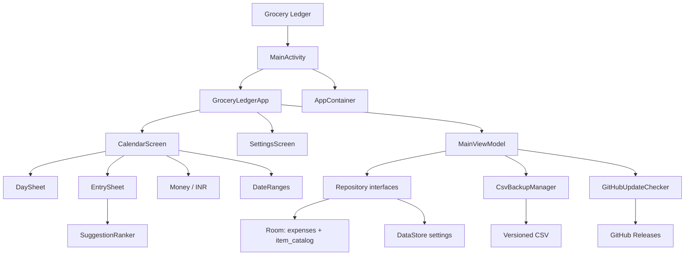

# Project Knowledge Graph

This is the map for LLM sessions and humans joining the project. It complements the requirements and code; it does not replace either.

- **Machine-readable graph:** [`docs/knowledge-graph.json`](knowledge-graph.json) — 61 nodes, 84 edges
- **LLM handoff:** [`AGENTS.md`](../AGENTS.md)
- **Requirements + completion matrix:** [`REQUIREMENTS.md`](../REQUIREMENTS.md)
- **Architecture:** [`docs/ARCHITECTURE.md`](ARCHITECTURE.md)
- **Release process:** [`docs/RELEASING.md`](RELEASING.md)

Last updated: 29 October 2026.

Current release: **1.1.1** (versionCode 3). The manual GitHub update check is implemented; `v1.1.0` is published on GitHub, and `v1.1.1` is built locally and not yet published.

## How to use it in a new session

1. Read `AGENTS.md` first for invariants and commands.
2. Ask the graph for the area you are changing:

```powershell
python tools/knowledge_graph.py autocomplete
python tools/knowledge_graph.py --id data.csv
python tools/knowledge_graph.py --status pending
python tools/knowledge_graph.py --type feature
python tools/knowledge_graph.py --json update
```

3. Open the `path` values on the matching nodes.
4. Check `REQUIREMENTS.md` for acceptance criteria and current status.
5. Make the change, add tests, and update the graph/matrix if the feature or status changes.

The graph is intentionally small: it links the important modules, features, decisions, tests, and external dependencies. It does not duplicate source code.

## Graph at a glance



## Completed v1

| Area | Status | Where |
| --- | --- | --- |
| Calendar month grid, day totals, navigation, Today | Done | `ui/calendar/CalendarScreen.kt` |
| Day sheet, item list, exact total, empty state | Done | `ui/calendar/DaySheet.kt` |
| Add/edit/delete, undo, save & add another, validation | Done | `ui/entry/EntrySheet.kt`, `ui/MainViewModel.kt` |
| Day / week / month totals, integer paise, INR formatting | Done | `domain/`, `data/local/` |
| Autocomplete, ranking, last price/date, price chip | Done | `domain/suggestion/`, `data/local/` |
| CSV export/import, versioning, UID dedupe, preview/errors | Done | `data/csv/`, `data/backup/`, `ui/settings/` |
| Settings: week start, theme, delete all, about | Done | `ui/settings/SettingsScreen.kt` |
| Manual GitHub Releases update check | Done | `data/update/`, `ui/settings/` |
| Signed release build, stable package/key, versioning | Done | `app/build.gradle.kts`, keystore outside repo |
| Unit, Room, CSV, update, and Compose/Robolectric tests | Done — 46 tests | `app/src/test/` |
| Lint / build | Done — 0 lint errors | `./gradlew lintDebug` |
| Physical-device visual/performance QA | Pending | Needs a real phone |
| Automatic update checks | Deferred | Decision needed on privacy/UX |
| Spend-intensity shading, recent-item chips | Deferred optional requirements | `REQUIREMENTS.md` |

Full per-requirement status is in `REQUIREMENTS.md` section 17.

## Invariants an LLM must preserve

1. Money is integer paise; never floats.
2. Entries store epoch-day dates, not timestamps.
3. Totals are derived SQL sums; never stored.
4. `entry_uid` is stable across export/import; import is merge-only and idempotent.
5. CSV is versioned (`format_version=1`); older app versions must reject newer files.
6. Room schema changes are additive with migrations; no destructive migrations.
7. `applicationId` (`dev.groceryledger`) and the release signing key never change.
8. Network use is limited to the user-initiated GitHub update check. No analytics, ads, or sync.
9. UI → ViewModel → repository interfaces → Room/CSV; UI never imports Room entities.
10. All user-facing strings live in resources; keep accessibility and large-font behavior.

## Important flows

### Add an entry

`CalendarScreen` → `MainViewModel.openAdd` → `EntrySheet` → `save` → `OfflineExpenseRepository.add` → Room transaction + `item_catalog` refresh → Flow emits → summary/day sheet update.

### Autocomplete

Name input → 120 ms debounce → `observeSuggestions` → escaped catalog `LIKE` query (≤500) → `SuggestionRanker` → six suggestions with last price/date.

### CSV restore

File picker → `CsvBackupManager.analyze` → `CsvBackup.analyze` (validate, dedupe by UID) → preview → `importAll` transaction → catalog rebuild → totals/suggestions refresh.

### Update check

Settings “Check for updates” → `GitHubUpdateChecker` → GitHub `/releases/latest` → semver comparison → dialog with notes → browser opens the release page. The app never downloads or installs an APK itself.

## External dependencies and source

- Repository: <https://github.com/chethankumarsk/personal_grocery_cost_tracker_phone_app>
- Releases: <https://github.com/chethankumarsk/personal_grocery_cost_tracker_phone_app/releases>
- Update API: `https://api.github.com/repos/chethankumarsk/personal_grocery_cost_tracker_phone_app/releases/latest`
- Published release: **v1.1.0** (29 October 2026) with `GroceryLedger-1.1.0-release.apk`, SHA-256 `027e7416228dcb7893d76778e60182fa99257e7ca8c33e3c7cb667992b7f8ef1`.
- GitHub Releases is preferred over raw Git tags because it provides release notes, a stable latest release, and a signed APK asset.

## Maintaining the graph

When adding or changing a feature:

1. Add/update nodes in `docs/knowledge-graph.json` for the feature, module, requirement group, or decision.
2. Add edges to the files/modules/tests it uses or implements.
3. Set `status` to `done`, `partial`, `pending`, or `deferred`.
4. Update this document’s summary table and `REQUIREMENTS.md` section 17.
5. Validate:

```powershell
python -c "import json; json.load(open('docs/knowledge-graph.json', encoding='utf-8'))"
python tools/knowledge_graph.py
```

The graph schema is intentionally simple: every node has `id`, `type`, `label`, `status`, and optional `path`/`summary`; every edge has `from`, `to`, and `type`.
